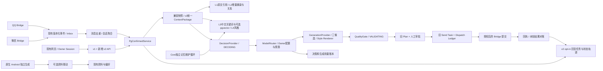

# v2 兼容架构与实施边界

本文件记录P0–P5实现及P6离线验收/灰度演练；真实上线验收单独保留待验项。需求来源见 [RFC](reconstruction-v2-rfc.md)，源码证据见 [审计](rewrite-audit.md)。

## P0/P1 实际架构

采用增量接入，不把数据库、Bridge、UI 或独立 Android 推倒重写。默认旧管线；新任务是旧流程的持久化生命周期记录，发送权威仍只有一套。进程崩溃后可能重新调用候选模型，但版本/当前任务/发送账本确保过期结果不生效；没有宣称模型调用本身 exactly-once。

## 已实现与后续层次

| 阶段 | 目标 | 复用边界 |
| --- | --- | --- |
| P2 已实现 | 统一ContextPackage、L1预算/引用、L2增量摘录/关系和预览 | 复用PgDataProvider权限/证据/快照；仅opt-in会话使用v2组装器 |
| P3 已实现 | 保守异步提取、待确认记忆/修订/TTL/删除/混合检索和L4风格 | 复用facts/evidence、反馈日志和humanlike；Embedding默认关闭，新增最小记忆管理界面 |
| P4 已实现 | 严格DecisionResult/DECIDING、配置/联系人路由、三候选、风格/质量、预算/用量 | 扩展原Intelligence工厂，保留v1接口；发送权限仍由编排决定 |
| P5 已实现 | 电脑/手机Web同任务审批、诊断/重试、记忆中心、模型配置、实际送达反馈 | 复用工作台、草稿/反馈和发送账本；原生Android仍独立运行 |
| P6 | 回放、灰度、成本与延迟指标、恢复/回滚演练 | 复用隔离测试与 eval 工具，不借真实聊天做未经授权的试验 |

原生 Android 当前有独立运行价值，本轮保留。统一协议和记忆字段可以先共享设计；是否改为电脑后端依赖型产品，不能仅因为 RFC 写了手机 Web 就替用户决定。这个选择不阻塞电脑P0–P5。新维护循环在Core启动，Bridge保留原发送职责；本轮未构建或安装Android。

## P6离线验收

160场景回放与数值门槛、盲测题包、真实PostgreSQL召回/性能、按模型计量及会话回滚见[P6验收](p6-acceptance-v2.md)。报告判定只有offlinePassed，不赋予平台、部署或发送权限；本轮releaseReady=false。
