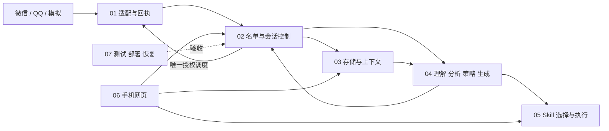

# 架构与工程边界

基线：PRD v1.3；契约版本 0.2.0（设计基线，机器类型包尚未建立）。产品待定项只在 [decisions.md](decisions.md) 定稿。当前状态见 [requirements.md](requirements.md)。

## 1. 技术建议

采用 TypeScript 模块化单体：一个仓库、一套契约、一个 PostgreSQL、一个应用镜像的 API 与 worker 两种进程。手机网页采用 React + Vite，后端 Fastify，数据库访问采用参数化 SQL + pg，迁移集中管理。首版不引入微服务、Redis、消息中间件、独立向量库或专属模型训练；中文检索先用联系人范围过滤+近期消息+摘要+关键词，可在效果评测证明需要后增加向量检索。

这是工程方案，不代表本人已购买服务或确认待定产品规则。依赖补丁版本在工程初始化时核验并锁定，避免这里维护第二套锁文件。

| 组件 | 建议 | 理由与限制 |
| --- | --- | --- |
| 运行时 | Node.js 24 LTS，TypeScript strict | 前后端共享契约；Node 官方当前将 24 列为 LTS；不依赖本机已有版本符合要求 [S1] |
| API | Fastify 5，JSON Schema/Ajv 边界验证 | 功能少、明确模块端口；官方 LTS 表覆盖该代，建项再核验 Node 24 与插件组合 [S2] |
| 手机网页 | React + Vite，响应式单页，同源 REST，轮询待办/状态 | 无 SEO 或服务端渲染需求；浏览器关闭时轮询停止，不算可靠通知；前端只展示后端 allowedActions |
| 数据和队列 | PostgreSQL 17 最新受支持补丁，pg、SQL migrations | 单库事务维护 inbox/outbox、版本和任务租约；17 仍受支持 [S3]；SKIP LOCKED 适合任务领取但不能代替业务锁 [S4] |
| 媒体 | 私有持久卷 + MediaStore 接口，需要时迁移私有对象存储 | 小规模降低服务数量；不把媒体放公网静态目录；保存与备份周期待 D07 |
| 模型 | ModelGateway 抽象文本生成、视觉理解、语音转写；假实现先行 | 不锁厂商或自称所有模型能理解动态表情；D06 选供应商后按实际模型分别测质量、费用、时延、数据设置 |
| 部署 | Linux 单机 Docker Compose，反向代理提供 HTTPS；API、worker、数据库及媒体卷 | 官方支持 Compose 单机部署 [S5]；不是高可用，需备份/恢复；平台若要求专用常在线设备或 Windows，adapter 独立桥接，核心不迁移 |
| 登录 | 单个本人账号，无注册；成熟密码哈希库、HttpOnly/Secure 会话 cookie、CSRF/Origin 校验与限速 | 单用户降低复杂度；凭据不入仓库；真实公网启用前由 07 验证登录、会话撤销、鉴权及恢复方式 |
| 测试 | 模块测试、真实 PostgreSQL 契约/竞态测试、手机视口浏览器 E2E、真实平台专项 | 假平台/假模型保证可复现；不代替真实 AC23 或生成质量验收 |

暂以 2 vCPU / 4 GB RAM 作为不跑本地大模型的测试起点，仅为容量假设，不是购买建议、报价或 SLA。实际规格取决于媒体并发、连接器及数据库测量。月成本模型：云主机+存储/备份+模型输入输出 token+转写/图片计费+接入服务/常在线设备+通知。07 在 D06 数量与预算确定后给出实时报价、限额和超额暂停机制；本次不产生费用。

## 2. 数据流与模块权责



01 只提供能力、输入事件、媒体和受保护的发送端口。02 是业务发送的唯一入口，也是权限、会话状态、确认、调度与发送任务唯一写入者。03 管理消息/事实/摘要/证据存储和隔离，不判定发送权限。04 产出推测、决策与候选，不写策略授权。05 管理技能定义与调用，不拿平台凭据、不拥有发送工具。06 通过 API 提交本人命令，不自行实现另一套权限。07 维护测试环境和发布证据，不代改业务规则。

媒体归属：01 取原文件与平台元信息 → 03 管理私有资产及来源 → 04 理解并返回含版本和失败原因的结果 → 03 持久化证据 → 02 判断是否能继续。表情批准由本人通过 06 提交，03 存批准记录，02 每条发送复核，01 校验平台能力。

分析归属：04 负责算法与结果语义，03 存证据/快照/派生依赖，02 订阅失效并复核，06 展示纠正。Skill 调用由 04 在阶段内请求 05；05 只能拿 03 已裁剪的上下文投影。联系人策略只由 02 的本人配置命令改写；各模块不得跨模块直写表。

所有入站数据先验签/认证、去重及名单门控，未入名单仅保留必要发现元数据，不调用媒体/分析/生成。发现元数据和审计的具体保留周期仍待 D07。历史导入/试用与 live 显式分区；不能通过换个事件名流入发送队列。

## 3. 建议目录与写入归属

以下为目录归属；G0 已落盘公共契约与 PostgreSQL 底座，其余目录按任务逐步建设，不能把目录存在视为生产能力完成。

```text
apps/
  api/                     # 总控启动与路由装配，06 实现管理 API 适配
  worker/                  # 总控装配，02 调度，07 生命周期
  web/                     # 06
packages/
  contracts/               # 总控维护 schema、类型、端口、错误、事件
  platform/                # 01: mock/, wechat/, qq/；具体桥接待验证
  orchestration/           # 02: policy/, conversations/, scheduling/, dispatch/
  data/                    # 03: messages/, facts/, context/, imports/, media/, analyses/
  ai/                      # 04: understanding/, analysis/, strategy/, generation/, checks/
  skills/                  # 05: registry/, selection/, execution/, trials/
  infrastructure/postgres/ # 总控: 事务、事件 inbox/outbox、发送账本、迁移器
db/migrations/             # 总控分配全局编号；03 等模块提交迁移提案
tests/
  contracts/               # 总控 + 07
  integration/             # 07 + 对应主责模块
  e2e/                     # 07 + 06
  fixtures/                # 07；脱敏或合成，无真实凭据
deploy/                    # 07: compose、反代、备份、恢复
docs/tasks/                # 本次七份任务提示词
docs/reports/              # 后续模块交付、接入实验、验收证据
```

同仓协作先确定文件归属；不同任务不同时修改 package.json、锁文件、公共契约或迁移编号。公共需求以变更提案交总控合并。可以使用独立分支/worktree，但本次尚未初始化 Git，也不要求自行创建 Codex 任务。

## 4. 一致性与故障边界

业务状态和 outbox 同事务写入；消费者至少一次投递，以 inbox 去重。每联系人串行的短事务 + conversationRevision CAS，模型在锁外运行，结果回来再对版本。平台提交用持久化发送账本与唯一 sendKey；本地幂等不等于平台 exactly-once，无法核对的未知结果保持阻塞。G0 的 `withDispatchLease` 暂以单库全局 advisory lock 串行提交、暂停与依赖失效的提交边界，个人部署流量低时以简单和安全为先；网络提交前已持久写入 `SUBMITTING`，异常恢复只能转 `RESULT_UNKNOWN`。02/03 现有持久 provider 已接入该边界，后续 provider 必须沿用，不能直接调用底层 claim 后绕开锁；鉴权入口、worker 装配与真实平台仍未交付。详细对象和状态只在 [contracts.md](contracts.md) 定义。

全局暂停、策略/证据/技能失效必须先更新可同步检查的 epoch/version，再异步传播清理；不能仅依赖事件最终到达。03/05 修改依赖时与依赖版本更新、outbox 一起提交；02 dispatch 读取当前版本。G0 的 0002 数据表启用联系人 RLS，0003 修订事实策略的 scope 判断（空字符串等同无 scope）；运行角色必须受限且不得具备 BYPASSRLS，02/04 读取须在可信服务事务中设置联系人 scope，本人跨联系人管理走独立鉴权查询端口。任何自动确认式的“模型认为可以”都无效。

一台云主机故障会影响全部服务；进程重启不是可用性保证。启动恢复必须先 reconcile 后允许新发送；数据库/adapter 不可用默认拒绝 dispatch。平台要求本地常开电脑的路线不能通过关机要求；可讨论常在线设备或云端桥，但不得自行采购/替换身份。

## 5. 外部查证来源

查证日期 2026-09-22；这些资料支持技术建议，不构成此项目实测结果。

- S1 [Node.js 发布状态](https://nodejs.org/en/about/previous-releases)。
- S2 [Fastify LTS](https://fastify.dev/docs/latest/Reference/LTS/)。
- S3 [PostgreSQL 版本支持政策](https://www.postgresql.org/support/versioning/)。
- S4 [PostgreSQL SELECT 与 SKIP LOCKED](https://www.postgresql.org/docs/current/sql-select.html)。
- S5 [Docker Compose 单机部署用途](https://docs.docker.com/compose/intro/features-uses/)。

平台资料与未能查证的事项集中在 [platform-validation.md](platform-validation.md)。未引用的库名称仅是工程建议，不声称具体版本/当前平台能力已经验证。
