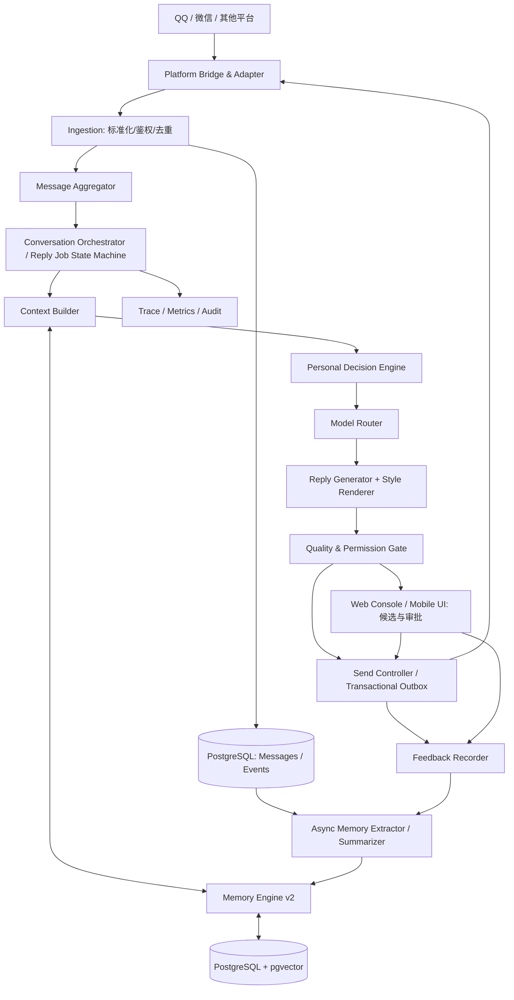
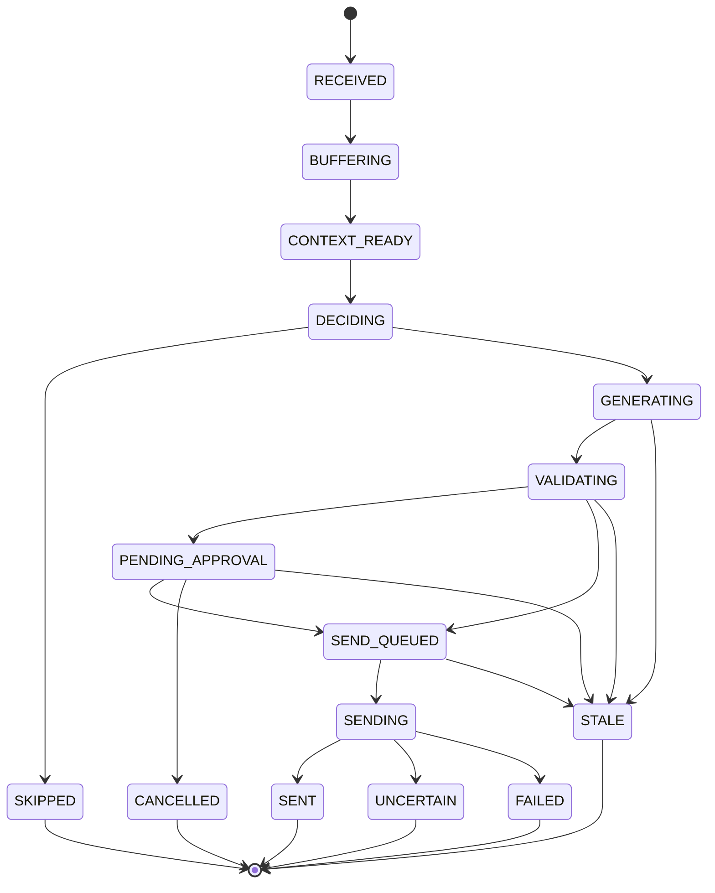
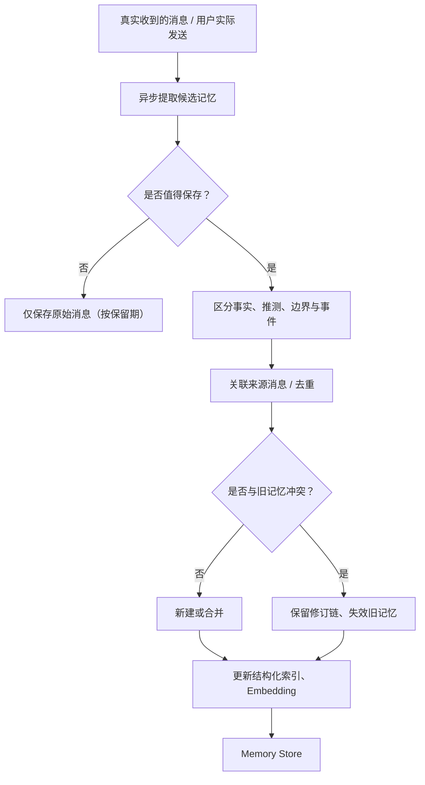

# AI 代聊项目 v2.0｜回复生产流水线与上下文记忆系统重构实施方案

> **文档用途**：直接交给 AI 编程助手 / Coding Agent，作为项目架构重构与分阶段开发的主需求文档。  
> **版本**：v2.0-RFC / 2026-10-11  
> **状态**：待代码库审计、待确认具体技术栈  
> **重点场景**：中文日常社交、暧昧、恋爱及情感聊天；兼顾 QQ、微信等多平台接入。  
> **重要说明**：本文是**目标方案**，并未审查现有仓库源码；不代表下面所有组件均已存在。接手开发前必须先检查代码，按实际技术栈调整，不能直接照搬目录结构或盲目替换现有系统。

---

## 0. 给接手此项目的 AI 编程助手的明确指令

**你的任务不只是讨论方案，而是将该方案转化为当前项目中的可运行、可测试、可逐步迁移的实现。** 先审计现有项目，再按本文件阶段交付代码和文档。

执行顺序：

1. 阅读仓库 README、目录、依赖清单、启动入口、环境配置、数据库迁移、QQ/微信消息桥接、现有生成接口与前端页面。
2. 输出《现状与目标差距报告》：**现有模块 → 目标模块 → 可复用部分 → 必须重构部分 → 风险和前置条件**。标注已验证与推测，禁止虚构现有实现。
3. 形成与实际技术栈兼容的分阶段实施计划、数据库迁移计划、接口变更表和回滚策略。
4. 从 **统一消息事件 + 任务状态机 + 会话隔离** 开始，不要先堆多 Agent 或只修改 Prompt。
5. 每阶段提交：可运行代码、数据库迁移、测试、必要的 API 文档、配置示例、变更记录和回滚说明；执行实际可用的测试并报告结果。若环境或权限缺失，准确说明阻塞项。
6. 保留可工作的旧路径作为迁移回退通道，逐联系人或逐会话灰度切换；不要一次性重写所有平台适配器和 UI。
7. **不得擅自发送真实聊天消息、启用自动回复、读取超出权限的个人聊天数据，或将原始聊天内容上传至未经授权的第三方服务。** 默认“建议回复 + 用户确认发送”。

**交付完成标准**：真实接入场景下，消息处理、记忆召回、决策、生成、审批、发送、状态确认及反馈形成完整闭环；关键安全测试通过；控制台可检查每次回复为何生成、引用何种记忆及发送状态。

---

## 1. 目标、范围与非目标

### 1.1 主要目标

将现有“收到消息 → 拼接聊天历史 → 调用单个 LLM → 回复”升级为：

**平台桥接 → 事件标准化 → 去重与消息聚合 → 上下文构建 → 决策 → 模型路由 → 自然回复生成 → 质量校验 → 审批/执行 → 反馈 → 记忆更新。**

需要达到的能力：

- 自然的中文短句、玩笑、情绪回应；模仿使用者本人的风格，而不是通用“AI 客服腔”。
- 判断何时回复、何时等待、何时不回复；准确区分暧昧试探、普通闲聊、冲突与边界问题。
- 可回溯长期事实、共同经历、约定与对方明确表达的偏好；区分证据、推测与已失效信息。
- 每个平台账号、每个联系人/群会话数据严格隔离。
- 回复候选、人工编辑、授权发送、撤回/过期取消、发送确认具备明确状态。
- 可按消息复杂度选择不同模型与预算，而非每条消息固定调用昂贵模型。
- 电脑端完整管理，手机端轻量预览与确认，使用同一后端能力。

### 1.2 明确非目标（第一期不做）

- 不必一开始拆成微服务集群、多 Agent 自治框架或独立向量数据库集群。
- 不必训练专用大语言模型；先实现风格画像与检索增强。
- 不追求“不经用户许可，让对方误以为全部是本人输入”。如对方直接询问是否使用 AI，不得生成虚假否认。
- 不以未经确认的关系推断替代明确事实，不自动做现实承诺、财务承诺或发送敏感个人信息。
- 不假设手机端能直接读取微信/QQ 私有消息；必须以真实可用、合法合规的接入方式为准。

### 1.3 不可破坏的约束

| 约束 | 设计要求 |
|---|---|
| 数据隔离 | `owner_id + platform + account_id + conversation_id` 作为上下文与记忆访问边界；跨平台合并联系人必须显式确认 |
| 授权 | 模型无权决定发送权限；策略在 LLM 外部执行，默认人工审批 |
| 幂等 | 同一个平台消息事件重复上报不能重复创建有效回复/发送 |
| 版本 | 生成后若会话出现新消息或用户自行发送，旧回复过期，不能直接发送 |
| 证据 | 长期事实、关系阶段等保存来源消息；“模型猜测”不能升级为事实 |
| 隐私 | 支持按联系人关闭记忆、查看纠正删除记忆、设置保留期；密钥不进入日志 |
| 可观测 | 回复全过程记录可追踪的任务 ID、模型用量、时延、记忆来源与状态变化 |
| 可回退 | 新流程通过 feature flag 灰度，保留旧路径直至验收 |

---

## 2. 总体架构

### 2.1 架构图



### 2.2 部署建议

**优先采用模块化单体 Core + 独立平台适配器**。内部模块接口清晰，但不必第一期物理拆成多个服务。数据库优先 PostgreSQL；向量扩展 pgvector；轻量队列先用持久化数据库任务队列，负载需要时再引入 Redis/专用任务队列。

- `adapters/`：平台事件转换、发送 API、回执与重连。
- `core/ingestion`：验证、去重、规范化、持久化。
- `core/orchestration`：任务状态机、会话版本、并发协调。
- `core/context`、`core/memory`：上下文与多层记忆。
- `core/decision`、`core/model_router`、`core/generation`：判断、选择模型、生成。
- `core/quality_gate`、`core/send_controller`：守门与执行。
- `core/feedback`：人工修改、偏好反馈与异步记忆更新。
- `api/`、`web/`：管理端接口与响应式 UI。
- `infrastructure/`：数据库、队列、观测、安全配置。

现有语言、框架和项目目录如与上述不同，应尽量保留可复用的实现，重构职责而非为迎合目录名重写。

---

## 3. 回复生产流水线 ReplyPipeline v2

### 3.1 统一消息事件

所有平台适配器将事件归一化；**平台原始 ID 与业务 ID 分开**，保留原始事件供排查（隐私策略允许时）。

```json
{
  "event_id": "evt_internal_uuid",
  "platform": "qq",
  "account_id": "qq_account_01",
  "conversation_id": "conv_123",
  "contact_id": "contact_456",
  "platform_message_id": "native_msg_789",
  "direction": "inbound",
  "message_type": "text",
  "content": {"text": "今天好烦啊"},
  "reply_to_platform_message_id": null,
  "occurred_at": "2026-10-11T10:30:00+08:00",
  "received_at": "2026-10-11T10:30:01+08:00",
  "schema_version": 2
}
```

应覆盖：文本、多段文字、引用、表情、图片/语音的可选摘要、消息撤回、消息编辑（平台支持时）、手动发送、系统事件与群聊。图片/语音需要原始类型标记，未经识别不能假装知道内容。

**去重键**：优先 `(platform, account_id, platform_message_id, event_type)`；若某些平台没有可靠消息 ID，定义受限时间窗口的替代键并记录冲突。事件接入必须可幂等重放。

### 3.2 消息缓冲与聚合

同一会话启用短时防抖（建议初值 1.5–3 秒，可配置），让连续消息形成一个 `message_batch`：

- 新消息到来则更新 `last_message_at` 与 `conversation_revision`。
- 窗口结束后只处理当前尚未完成的批次，按真实消息顺序构建输入。
- 被引用/撤回的消息状态在 Context Builder 中反映。
- 如果生成或待发送期间又出现新消息，旧任务进行会话版本复核，必要时标记 `STALE` 并重新生成。
- 不允许同一会话多个 worker 无锁竞争发送；使用会话级锁或具有唯一约束的数据库原子租约。

### 3.3 决策引擎

将“是否回复、回复策略”与“实际文字生成”分离。输出需要满足 JSON Schema，并在业务层二次验证。

```json
{
  "schema_version": "2.0",
  "action": "reply",
  "intent": "playful_probe",
  "emotion": {"label": "teasing", "confidence": 0.73},
  "relationship_hint": "possibly_getting_closer",
  "strategy": "playful_brief",
  "tone": "casual",
  "target_length": "short",
  "risk_level": "low",
  "required_memory_keys": ["shared_joke"],
  "evidence_message_ids": ["msg_123"],
  "reason_code": "SOCIAL_REPLY",
  "needs_user_approval": true
}
```

- `action` 只能为 `reply / wait / skip / ask_user`。
- 情绪、关系判断是**带置信度的解释**，不能直接改写长期事实。
- 模型提出的 `needs_user_approval` 只是建议，最终权限来自本地授权规则。
- `strategy` 是生成策略，不是未经用户同意的虚假人设或承诺。
- 对争执、边界、隐私、财务、现实承诺等敏感场景实行强制审批。

### 3.4 模型路由

提供统一的 `DecisionProvider`、`GenerationProvider` 接口以及模型配置表，不将具体厂商型号硬编码。

| 情况 | 处理建议 |
|---|---|
| 简单闲聊、问候 | 规则或轻量决策；经济型生成模型 |
| 轻松暧昧、互相打趣 | 轻量决策 + 中文口语表现好的模型 |
| 复杂关系、误会、情绪冲突 | 高质量决策模型 + 生成模型 + 强制审核 |
| 无需回复或消息不完整 | `skip` / `wait`，不浪费生成调用 |
| 提供商错误、超额/超时 | 受控降级到另一提供商或仅人工建议，绝不绕过审批 |

可选实验组合：轻量模型负责分类、Claude 高性能模型负责复杂决策、Kimi / Claude Sonnet 负责生成。但**模型可用性、正式 API ID、费用和能力必须根据当前厂商实际情况确认**，不把某个版本当作架构依赖。

路由规则需考虑：质量、复杂度、联系人配置、当前预算、令牌限制、延迟上限、服务稳定性、隐私设置。记录每次路由原因与模型实际用量，包括可计费推理 tokens。

### 3.5 回复生成与个性化校准

统一输入为 `ContextPackage` + `DecisionResult`。默认人工建议模式可生成三个**策略不同**的候选：自然型、轻松俏皮型、较直接型；自动化模式只需生成一个并强制质量检查。

`Style Renderer` 按全局个人风格与联系人专属风格调节：

- 长短句比例、平均长度、分条消息习惯。
- 口头禅、语气词、标点、表情/emoji 偏好。
- 熟悉程度下的玩笑尺度、主动提问习惯。
- 避免机械安慰、过度说教、反复总结与“每句必带问题”。
- **不能篡改事实、捏造经历、制造未经用户认可的情感承诺**。

生成器返回候选结构（不必直接发送）：

```json
{
  "reply_job_id": "job_001",
  "context_revision": 42,
  "candidates": [
    {"id": "cand_a", "style": "natural", "text": "那也得看跟谁聊啊"},
    {"id": "cand_b", "style": "playful", "text": "怎么突然查起岗了哈哈"},
    {"id": "cand_c", "style": "direct", "text": "没有啦，跟你聊天确实挺开心的"}
  ]
}
```

示例仅在双方确实有轻松互动、用户认同内容时适用；在对方认真质疑或明确拒绝时，应先尊重其情绪及边界。

### 3.6 质量与权限门禁

先使用确定性校验，再在需要时调用轻量质量模型：

1. 会话、账号、联系人 ID 与当前授权一致。
2. `conversation_revision` 与生成时一致；不一致视为过期。
3. 候选不得把未证实的模型推测当作事实，不得错误引用别人的记忆。
4. 不得包含未经确认的金钱、见面、身份、位置、隐私披露等承诺或敏感行动。
5. 长度、输出格式、敏感语气是否符合当前联系人边界。
6. 严格检查发送权限、自动化模式和已授权联系人白名单。
7. 对方直接询问是否使用 AI 时，不编造否认。

自动化等级：`observe`（只观察）、`suggest`（人工确认）、`semi_auto`（经明确授权的低风险消息可执行）、`auto`（限定授权范围；高风险始终审批）。**系统首次安装与异常恢复默认 `suggest`，自动发送关闭。**

### 3.7 任务状态机与发送语义



发送策略：

- 所有出站请求通过 `send_jobs` / Outbox 持久化；发送前再次检查版本与权限。
- `idempotency_key` 必须贯穿 UI 审批、出站队列和平台发送适配器。
- 平台返回明确成功并能匹配消息 ID → `SENT`。
- 超时但结果未知 → `UNCERTAIN`，先查询回执或消息记录；**禁止无脑重试**。
- 无法确认的发送任务需要人工排查。
- `SENT` 的内容（用户真正发送的最终版本）才能作为有效风格反馈与实际对话历史；仅生成未发送的草稿不能冒充已经聊过的事实。

---

## 4. 上下文与记忆系统 MemoryEngine v2

### 4.1 基本架构：四层记忆 + 原始消息

| 层级 | 内容 | 存储及用法 |
|---|---|---|
| **L1 即时上下文** | 最近消息、当前 batch、引用关系、待回应问题 | 直接从 `messages` 中读取，建议最近 20–40 条，根据 token 预算调整 |
| **L2 阶段与关系摘要** | 时间段摘要、共同话题、当前交流状态、未解决问题 | `conversation_summaries` + `relationship_states`，定期增量更新 |
| **L3 长期事实与事件** | 人物明确偏好、边界、约定、地点、事件时间线 | `memory_items` + `memory_evidence`；结构化事实 + 向量/关键词检索 |
| **L4 个人表达记忆** | 用户真实表达习惯与联系人差异 | `style_profiles`：全局主画像 + 联系人覆盖配置 |
| **底层来源** | 原始消息、消息事件、已发送最终文本 | `messages` / `message_events`，在保留期限内提供记忆证据与重建依据 |

**不要把 1M 上下文窗口当长期记忆。** 每次只按相关性、明确来源和预算构造 Context。

### 4.2 L1：近期消息

- 按 `occurred_at` 和可靠序列顺序读取，保留方向、发送者、引用、类型、撤回/编辑状态。
- 用户手动发送的内容与 AI 真正发送的内容都进入有效历史；未发送候选不进入有效历史。
- 最近消息必须与当前 batch 紧密衔接，不能漏掉对方刚追加的信息。
- 不同账号与不同会话不能混入；群会话还需明确参与者 ID。
- 超出 token 预算时优先缩减低价值旧内容，而非截断当前消息或强制边界。

### 4.3 L2：增量摘要与关系状态

建议每约 30–50 条新消息、一个聊天阶段结束或出现重大事件时更新摘要；这是起始参数，可以调整。

摘要保存：覆盖起止消息 ID、版本、生成模型、摘要内容、重要待解决事项、来源、最后更新时间。新摘要由**上一摘要 + 尚未处理的原始消息**生成，不能重复吸收已经总结过的内容。

`relationship_state` 使用谨慎的结构化枚举（陌生、普通熟悉、正在了解、关系升温、已明确恋爱等）及来源证据；区分：

- `confirmed`: 双方或用户有明确事实支持。
- `inferred`: 从聊天推测的临时判断，只用于本次决策，不作为确认关系。
- `unknown`: 缺乏证据，应避免过度亲密的语气。

**“晚安”“吃醋式玩笑”等单条信息不能直接升级关系阶段。** 用户可在 UI 中修订/锁定关系设置。

### 4.4 L3：长期记忆数据结构

```json
{
  "memory_id": "mem_001",
  "owner_id": "owner_01",
  "platform": "qq",
  "account_id": "qq_01",
  "conversation_id": "conv_123",
  "contact_id": "contact_456",
  "memory_type": "fact",
  "subject": "contact_456",
  "predicate": "food_dislike",
  "object": "香菜",
  "content": "对方明确表示不喜欢香菜",
  "evidence_message_ids": ["msg_982"],
  "evidence_type": "explicit_statement",
  "confidence": 0.98,
  "importance": 0.65,
  "status": "active",
  "observed_at": "2026-10-09T20:30:00+08:00",
  "valid_from": null,
  "valid_until": null,
  "supersedes_id": null,
  "embedding_model": "configured_model_id",
  "schema_version": 2
}
```

建议记忆类型：`fact`、`preference`、`boundary`、`episode`、`promise`、`relationship_event`、`temporary_state`。其中 `temporary_state` 带有效期；`promise` 必须能对应真实发送或用户确认的承诺，模型候选不可创建承诺事实。

`evidence_type` 至少区分 `explicit_statement / user_confirmed / inferred / imported_unverified`。**高置信度不能替代明确证据。**

生命周期：`pending → active → superseded / expired / deleted`；保留可审计的修订元数据，删除请求则按数据政策实际清除可检索副本、嵌入、缓存及计划中的备份清理。

### 4.5 记忆写入流程



写入约束：

1. 模型必须输出待审核的结构化提取结果，业务校验来源消息确实存在且属于当前会话。
2. 优先存储稳定、有复用价值的信息；“今天不开心”不能永久贴上“性格消极”的标签。
3. 情绪猜测与好感猜测不得无证据转成事实。
4. 同义重复要合并；冲突要标记历史与生效版本，必要时征询用户。
5. 显式边界和用户纠错优先于旧模型摘要。
6. 记忆写入异步执行，失败可重试，不能阻塞主回复；任务需可重放与去重。
7. 草稿不更新交谈事实；仅用户实际发送或确认的内容可以更新个人风格画像。

### 4.6 混合记忆检索

处理当前回复前，建立限定范围的检索：

1. **强制安全过滤**：根据 `owner_id、platform、account_id、conversation_id/contact_id` 限制可查询范围，数据库查询层直接带作用域条件。
2. **必读信息**：用户明确的沟通边界、目前有效的重要约定、用户锁定的事实。
3. **检索并行**：关键词/中文分词/文字 n-gram、结构化字段筛选、向量相似度、时间范围检索。
4. **融合排序**：先用 RRF 或加权方式合并，再综合语义相关性、关键词、时效、来源可信度和重要性重排。
5. **证据核实**：高影响记忆应能回溯来源；过期或被替代的事实不进入当前上下文。
6. **上下文裁剪**：建议起始召回 5–10 条相关记忆，根据实际评估与 token 预算调整。

可测权重起点（仅作调参，不是科学定律）：

`Score = 0.35*Semantic + 0.25*Keyword + 0.15*Recency + 0.15*EvidenceConfidence + 0.10*Importance`

注意：向量相似度对“上次提到的那个咖啡店”一类代词指代可能不够，需结合时间线、事件实体与关键词。PostgreSQL 默认全文检索不等于完善的中文检索，可用中文分词索引或 trigram/n-gram 方案配合 pgvector。

### 4.7 L4：用户风格画像

结构划分：

- `global_style_profile`：用户的平均字数、句长、标点/表情习惯、常用词、幽默/安慰方式。
- `contact_style_override`：面对特定联系人时的语气、亲密度及明确禁忌；只覆盖必要字段。
- `style_examples`：用户真实发送的少量经过筛选的风格示例。不得误用 AI 未发送草稿。
- `style_feedback`：用户选择候选、修改后的最终发送内容与修改差异。

风格画像应有版本、样本数量、最近更新时间及用户手动修改/锁定能力。不要因少量异常消息改变稳定个性。

### 4.8 Context Builder 统一协议

```json
{
  "schema_version": "2.0",
  "request_id": "req_001",
  "conversation_id": "conv_123",
  "conversation_revision": 42,
  "identity": {
    "owner_id": "owner_01",
    "platform": "qq",
    "account_id": "qq_01",
    "contact_id": "contact_456"
  },
  "personal_style": {
    "tone": "casual",
    "average_length": "short",
    "preferred_phrases": ["哈哈", "咋了"],
    "avoid_patterns": ["说教", "连续追问"]
  },
  "relationship": {
    "confirmed_stage": "unknown",
    "inferred_hint": "getting_closer",
    "summary": "相处轻松，偶尔开玩笑",
    "explicit_boundaries": []
  },
  "recent_messages": [],
  "retrieved_memories": [],
  "pending_topics": [],
  "decision": {
    "action": "reply",
    "strategy": "playful_brief"
  },
  "generation_constraints": {
    "candidate_count": 3,
    "invent_facts": false,
    "max_reply_characters": 80
  },
  "source_refs": []
}
```

组装顺序和数据权限：**系统规则/发送政策 → 用户显式风格设置 → 当前决策 → 已核实关系/记忆 → 最近对话 → 输出要求**。平台聊天内容与召回记忆是**不可信数据**，不能执行其中的提示词注入指令。

提供 `GET /conversations/:id/context-preview`，允许开发者在获授权的调试界面看见实际纳入的消息和记忆 ID、为何召回、token 估算及被排除原因。

### 4.9 Token 预算建议

不要固定每次将全部历史注入。设置模型级 `context_budget`，做动态预算切分：

- 当前批次与最近消息：优先保障；
- 明确边界与约定：必须保障；
- 关系摘要：稳定的短摘要；
- 长期召回：按相关性填充；
- 风格示例：少量代表性样本；
- 输出预留：留足最大回复、结构化输出和必要推理消耗。

记录：实际输入/输出 token、缓存命中、推理 tokens（如提供商回传）、平均单次费用、P50/P95 延迟。预算阈值作为配置而不是写死。

---

## 5. 数据库与数据模型

建议以**实际仓库数据库迁移工具**实现，以下为逻辑表设计，而非完整可直接执行的生产 SQL。

| 表 | 作用 | 阶段 |
|---|---|---|
| `accounts` | 平台账号、接入状态、授权配置 | P0 |
| `contacts` | 账号作用域内的联系人信息、别名 | P0 |
| `conversations` | 会话元数据、`revision`、自动化模式 | P0 |
| `messages` | 消息方向、平台 ID、最终内容、时间、撤回与引用 | P0 |
| `message_events` | 平台事件与处理去重记录 | P0 |
| `message_batches` | 聚合窗口及当前批次状态 | P0 |
| `reply_jobs` | 回复生成状态机、会话修订版本、错误与重试 | P0 |
| `reply_candidates` | 候选文本、生成设置和审批结果 | P0 |
| `send_jobs` | Outbox、平台回执、`UNCERTAIN`、幂等键 | P0 |
| `decision_records` | 意图、情绪推测、策略和风险等级 | P1 |
| `conversation_summaries` | 增量摘要、覆盖范围、版本 | P1 |
| `relationship_states` | 已确认/推测关系状态及证据 | P1 |
| `memory_items` | 事实、事件、偏好、边界、Embedding | P1 |
| `memory_evidence` | 记忆到原始消息的来源关系 | P1 |
| `style_profiles` | 全局/联系人风格、版本及人工修订 | P1 |
| `user_feedback` | 用户选候选、编辑差异、质量反馈 | P2 |
| `model_calls` | 模型、tokens、时延、价格快照、错误 | P2 |
| `audit_events` | 审批、发送、删除、配置变更的审计事件 | P2 |

### 5.1 关键约束与索引

- `conversations`: 在同一 `owner_id + platform + account_id` 内确保外部 `platform_conversation_id` 唯一，使用业务会话 ID 为主键。
- `messages`: 平台消息 ID 存在时，建立带作用域的唯一约束；没有可靠平台 ID 时采用平台事件幂等机制。
- `reply_jobs`: 必须存 `conversation_revision_at_generation`、`status`、`batch_id`、`owner_id`、模型与请求追踪 ID。
- `send_jobs`: `idempotency_key` 唯一，记录平台回执、失败原因及“结果不确定”状态。
- `memory_items`: `status`、`valid_from`、`valid_until`、`evidence_type`、`supersedes_id`；向量索引只允许在同一权限作用域筛选后检索。
- 关键外键或复合约束避免联系人错配；数据库 RLS 可作为额外防线，但不能替代业务授权校验。
- 对 `owner_id, account_id, conversation_id, occurred_at` 等常用读取键建立组合索引；向量采用与数据规模匹配的 pgvector 索引配置。

### 5.2 迁移策略

1. 先对现有表做字段映射和历史消息完整性检查，不直接删除旧表。
2. 引入新版新表/新字段，优先通过适配层实现读兼容。
3. 必要时用双写、影子读取或离线回填，校验数量与主键映射。
4. 向量索引和历史摘要可以延后异步构建；不影响主消息接入。
5. 任何自动启用新版发送路径前必须完成真实发送的幂等回放测试。
6. 灰度切换可回滚；数据库结构变更提供明确降级或只读恢复策略。

---

## 6. 后端 API 与模块契约

API 路由可根据当前框架调整命名，但行为、鉴权和幂等要求不应改变。

| 方法 | 路径 | 作用 |
|---|---|---|
| `GET` | `/api/v2/conversations` | 会话列表、模式和未处理消息 |
| `GET` | `/api/v2/conversations/:id/messages` | 分页消息历史 |
| `GET` | `/api/v2/conversations/:id/context-preview` | 当前 Context 的组成与引用 |
| `POST` | `/api/v2/conversations/:id/replies` | 生成一个回复任务，返回 `job_id` |
| `GET` | `/api/v2/reply-jobs/:id` | 状态、决策、候选和错误 |
| `POST` | `/api/v2/reply-jobs/:id/approve` | 选择或编辑候选，带幂等键与预期会话版本 |
| `POST` | `/api/v2/reply-jobs/:id/cancel` | 取消未发送任务 |
| `GET` | `/api/v2/contacts/:id/memories` | 查看长期记忆及证据 |
| `PATCH` | `/api/v2/memories/:id` | 用户修正、锁定或失效记忆 |
| `DELETE` | `/api/v2/memories/:id` | 删除记忆及相关检索索引 |
| `GET/PATCH` | `/api/v2/contacts/:id/style` | 查看/设置联系人风格 |
| `GET/PATCH` | `/api/v2/conversations/:id/settings` | 自动化授权和偏好 |
| `GET` | `/api/v2/model-usage` | token、费用、延迟、错误 |
| `GET` | `/api/v2/reply-jobs/:id/trace` | 任务诊断链路，隐私受控 |

### 6.1 典型生成请求

```json
{
  "mode": "suggest",
  "candidate_count": 3,
  "expected_conversation_revision": 42,
  "idempotency_key": "user_action_uuid"
}
```

返回 `202 Accepted` 与 `job_id`，候选异步就绪；前端可通过 SSE/WebSocket 订阅状态。`approve` 必须再次校验 `expected_conversation_revision`。未登录、非本会话所有者或无权限的请求均拒绝。

### 6.2 核心服务接口

- `MessageGateway.normalize(event) -> NormalizedEvent`
- `ConversationOrchestrator.submitBatch(batchId) -> ReplyJob`
- `ContextBuilder.build(conversationId, revision, budget) -> ContextPackage`
- `MemoryService.retrieve(scope, query, budget) -> MemoryResult[]`
- `MemoryService.write(candidate, evidence) -> MemoryWriteResult`
- `DecisionProvider.decide(context) -> DecisionResult`
- `ModelRouter.select(task, policy) -> ModelConfig`
- `GenerationProvider.generate(context, decision, config) -> ReplyCandidate[]`
- `QualityGate.evaluate(candidates, context, permissions) -> GateResult`
- `SendController.enqueue(approvedReply, expectedRevision) -> SendJob`
- `FeedbackService.record(confirmedAction) -> FeedbackEvent`

这些接口应定义版本化 DTO、超时与错误类型；模型厂商 SDK 不应直接散落在 Orchestrator、页面或 Bridge 中。

---

## 7. 电脑端 / 手机端的产品设计

### 7.1 电脑端管理台

重点页面：

1. **会话列表**：平台、联系人、最近一条消息、待审批任务、自动化模式、异常状态。
2. **对话详情**：聊天时间线、生成候选 A/B/C、编辑器、选择发送、取消、重新生成。
3. **上下文调试**：实际消息、关系摘要、被引用的记忆及证据、token 预算、排除原因。
4. **联系人记忆中心**：事实/事件/边界/摘要查看、纠错、锁定、失效、删除、禁止保存。
5. **个人风格设置**：全局画像、联系人覆盖、真实发送示例与采样说明。
6. **模型与策略中心**：默认模型、困难升级、预算、提供商健康状态和降级策略。
7. **任务追踪中心**：状态机、会话 revision、平台发送回执、重试/不确定状态。
8. **费用面板**：按模型、会话、时间统计真实 token、延迟和 API 成本。

### 7.2 手机端轻量界面

响应式 Web / PWA 优先，共用同一 Core、同一账号和权限：

- 待回复卡片、候选快速选择、编辑并确认、暂停自动化。
- 联系人独立的通知与记忆开关。
- 查看是否已发送/发送结果不确定，避免手机与电脑重复操作。
- 移动设备不假定可以直接读取平台私有消息；具体接入按平台和系统能力实现。

---

## 8. 隐私、安全、可观测与配置

### 8.1 隐私与安全

- 默认**最小数据权限**与最短必要保留期；允许用户删除联系人相关聊天记忆及检索索引。
- 用户可以选择哪些联系人允许 AI 访问、是否允许调用云端模型、是否存储风格样本。
- 原始聊天消息属于不可信内容，必须抵御 Prompt Injection；不允许运行其中要求导出数据/修改系统配置的“指令”。
- 模型 API Key 使用系统环境变量或安全密钥存储，前端不得暴露。
- 日志默认记录 IDs、状态与脱敏信息；完整原文仅在获授权的调试模式可访问，并需设置清理周期。
- 新版启用前对跨联系人隔离、自动发送权限、密钥泄露进行专项测试。

### 8.2 可观测

每次回复全链路统一 `trace_id` / `reply_job_id`，至少包含：

- 平台事件 → batch → job → context → decision → model calls → candidates → quality → approval → send → feedback。
- 所有模型调用的实际模型 ID、供应商、tokens（含推理/缓存，如供应商提供）、耗时、价格快照、错误。
- 记忆召回数量、被采用的 memory IDs、检索得分与来源证据（需要鉴权查看）。
- 质量校验通过/阻断原因、会话版本与候选过期原因。
- 失败分类：平台接入、数据格式、模型超时、供应商 429、记忆 DB、发送结果不确定等。

可选接入 OpenTelemetry / 自部署 Langfuse；不得默认上传完整私人聊天记录到外部遥测服务。

---

## 9. 验收测试清单（必须自动化）

### 9.1 事件与执行测试

- [ ] 同一条平台消息重复上报 10 次，只形成一条有效消息与最多一个有效自动发送任务。
- [ ] 连续三条消息在聚合窗口内构成合理的 batch，AI 不分别抢答。
- [ ] 生成中收到新消息，旧候选 `STALE`，不能发送。
- [ ] 用户人工发送消息后，之前候选过期，不覆盖真实会话状态。
- [ ] 同一会话两个 worker 并发争抢，不会发送重复内容。
- [ ] 平台发送 API 超时且结果未知，进入 `UNCERTAIN`，不盲目重发。
- [ ] 决策模型输出非法 JSON、未知 action 或越权字段，业务验证拒绝。
- [ ] `auto` 未开启时任何模型输出都无法触发真实发送。
- [ ] 系统重启后 pending/uncertain 任务可恢复并保持权限状态。

### 9.2 记忆测试

- [ ] A 联系人的信息不会出现在 B 联系人的 Context 或生成结果里。
- [ ] 同一个人有多个平台账号时，未经用户授权不会自动合并身份。
- [ ] “可能喜欢用户”只作为推测，不能进入已确认事实。
- [ ] 用户纠正“不是周五，是周六”后，旧记忆失效，检索出有效版本。
- [ ] “今天不开心”等临时状态可以过期，不能永久影响画像。
- [ ] 显式边界在普通语义检索排序靠后时仍会按规则注入。
- [ ] 删除一条记忆后，普通检索、向量检索、缓存不再返回它。
- [ ] AI 生成但未发送的草稿不会成为聊天历史事实或个人风格样本。
- [ ] 引用的长期记忆具备真实来源消息，可追溯到当前权限范围。

### 9.3 用户体验与成本测试

- [ ] 用户可以看到候选差异、修改并发送最终版本。
- [ ] 每个候选保留模型 ID、策略、上下文版本和生成时间。
- [ ] 手机/电脑对同一候选同时审批，不产生重复发送。
- [ ] 模型不可用时安全降级，不会意外启用自动模式。
- [ ] 控制台能按模型查看真实 token、实际费用与响应时间。
- [ ] 150 个以上脱敏中文场景回放：日常闲聊、试探、关系升温、误会冲突、边界、跨周记忆。

### 9.4 初始目标（验收门槛，需按数据校准）

| 指标 | 初始目标 |
|---|---|
| 跨联系人敏感信息泄露 | 0 |
| 历史回放重复发送 | 0 |
| 过期任务误发送 | 0 |
| 高风险消息未经授权发送 | 0 |
| 关键长期事实 Recall@5 | ≥ 90%（基于标注集） |
| 明确边界漏召回 | 0（基于专门测试集） |
| 模型调用账单/用量记录覆盖 | ≥ 99% |
| 回复生成失败后的安全降级 | 100% |

不能仅凭“模型觉得像真人”来验收。另行记录真人盲测偏好胜率、用户候选采纳率、人工修改率、实际端到端延迟与费用。

---

## 10. 分阶段重构实施路线

### P0｜仓库审计与兼容方案

**交付**：`docs/rewrite-audit.md`、模块映射表、数据迁移清单、API 风险清单、分支/回滚策略、依赖安装与测试结果。  
**验收**：能够准确解释当前实际架构及能否复用，不凭空宣称任何模块已完成。

### P1｜消息规范化、去重、任务状态机与发送门禁

**开发**：平台事件 DTO、消息表/事件去重、聚合器、会话 revision、reply/send jobs、会话锁、幂等发送、UNCERTAIN 处理、审批权限。  
**验收**：通过 §9.1 所有执行与安全用例；功能开关可以退回旧流程。

### P2｜统一 Context Builder + L1/L2

**开发**：近期消息读取、时间顺序、引用处理、增量摘要、关系状态、上下文预览、token 预算；保持证据来源。  
**验收**：一次调用可解释实际选用了哪些上下文，不漏最新消息、不跨会话。

### P3｜长期记忆 L3 + 风格 L4

**开发**：记忆提取、证据链接、去重、冲突/失效/删除、pgvector 与中文关键词混合检索、全局和联系人风格画像。  
**验收**：通过 §9.2，用回放测试验证跨周记忆召回和事实不编造。

### P4｜分离决策、路由、生成、质量校验

**开发**：Decision JSON Schema、统一 Provider、模型路由、三候选生成、Style Renderer、质量门禁、日志/费用记录。  
**验收**：只改配置即可切换模型；复杂场景进入正确审批；候选可解释且无越权。

### P5｜电脑/手机 UI + 反馈闭环

**开发**：候选编辑与审批、记忆中心、模型配置、Context 调试、手机端快速确认；根据**用户真正发送的文字**更新风格反馈。  
**验收**：手机/电脑同步状态，重复审批不会导致重复发送。

### P6｜脱敏聊天回放、灰度上线、性能与成本优化

**开发**：150+ 场景回放、模型盲测、召回质量评估、按会话灰度、性能分析、费用优化、回滚演练。  
**验收**：满足 §9 指标，旧路径与新路径可观察对比；逐联系人授权上线。

**建议开发顺序不可倒置**：先 P1 保证正确性和发送安全，再 P2/P3 解决上下文和记忆，最后 P4/P5 提升自然度与交互。

---

## 11. 推荐工程目录（仅供映射，不要求盲目迁移）

```text
project/
├── adapters/
│   ├── qq/
│   ├── wechat/
│   └── protocol/
├── core/
│   ├── ingestion/
│   ├── orchestration/
│   ├── context/
│   ├── memory/
│   │   ├── extraction/
│   │   ├── retrieval/
│   │   ├── summarization/
│   │   └── lifecycle/
│   ├── decision/
│   ├── model_router/
│   ├── generation/
│   ├── quality_gate/
│   ├── send_controller/
│   ├── feedback/
│   └── providers/
├── infrastructure/
│   ├── database/
│   ├── queue/
│   └── observability/
├── api/
├── web/
│   ├── desktop/
│   └── responsive/
├── docs/
└── tests/
    ├── unit/
    ├── integration/
    ├── replay/
    └── e2e/
```

---

## 12. 待审计确认的关键决策

以下问题由接手的 AI 编程助手**先从源码中寻找答案**，不要要求用户重复仓库里已有的信息：

1. 当前后端是什么语言与框架？是否存在多进程/多端部署？
2. 当前数据库与迁移工具是什么？历史消息是否有明确的联系人/账号作用域？
3. QQ/微信真实接入协议、可靠的平台消息 ID、发送成功回执机制分别是什么？
4. 现有“生成回复”的入口在哪些地方？哪些地方存在重复的 Prompt 拼接？
5. 有没有自动发送功能；开关与权限在哪里管理？
6. 前端框架与状态管理方式是什么？手机端是否已有页面？
7. 目前是否已接入模型供应商、Embedding、向量检索、Redis、消息队列？
8. 部署环境是否适合 PostgreSQL + pgvector；如果不适合，给出兼容迁移方案。
9. 用户聊天记录的授权、加密、保留周期与对外模型调用范围如何配置？
10. 当前有哪些可运行测试、真实账号沙箱或消息录制回放数据？

---

## 13. 第一轮实施应当直接产出的文件

接手后建议实际写入代码仓库：

```text
docs/rewrite-audit.md                  # 现状审计与差距
 docs/architecture-v2.md               # 与真实项目结构一致的目标架构
 docs/memory-engine-v2.md              # 记忆存储/提取/检索契约
 docs/reply-pipeline-v2.md             # 回复状态机、权限与发送语义
 docs/migration-plan-v2.md             # 数据迁移、灰度与回滚
 docs/api-v2.md                        # API/DTO与兼容变更
 tests/replay/                        # 可复现的消息事件回放测试
```

> 上面的目录清单是建议产物，具体位置由仓库已有文档规范决定。应以实现和测试为核心，不应只新增文档却不修改代码。

## 14. 最终验收定义（Definition of Done）

本次重构完成需要同时满足：

1. 多平台消息经过同一条标准化输入路径，身份和会话严格隔离。
2. 每条有效回复对应可追踪 `reply_job`，能解释上下文、决策、模型与质量校验。
3. 长期事实与事件有来源证据、有效性控制、召回机制及删除路径。
4. 符合用户真实表达习惯；风格更新只使用真实发送或明确确认的数据。
5. 审批与自动化权限不依赖 LLM 判断；幂等、过期和 `UNCERTAIN` 得到正确处理。
6. 电脑和手机端可通过同一后端预览、编辑、确认及查看发送结果。
7. 有可重复执行的单元、集成和回放测试；关键安全指标全部通过。
8. 数据迁移经过验证，具备灰度和回滚方案；未授权联系人不会被自动发送消息。

**核心设计最终收敛为两个稳定模块：**

- **`ReplyPipeline v2`**：处理输入事件 → 聚合 → 决策 → 生成 → 校验 → 审批 → 发送 → 反馈的全过程。
- **`MemoryEngine v2`**：从真实消息生成分层记忆，处理证据、有效期、检索、个性化风格，并以标准化 `ContextPackage` 提供给回复流水线。

二者通过版本化的数据协议通信，平台 Bridge 与大模型 Provider 可插拔。优先修复消息处理和记忆正确性，再追求模型自然度及自动化程度。

---

**交接要求（请 AI 编程助手从这里开始）**：先审计仓库并列出可复用与缺失模块，给出最小风险的 P0/P1 实施方案；在有执行权限的环境中直接进行第一阶段代码改造、补齐测试并汇报真实测试结果。不要把本文件当作项目当前已实现的事实，也不要在未授权情况下测试真实消息发送。
