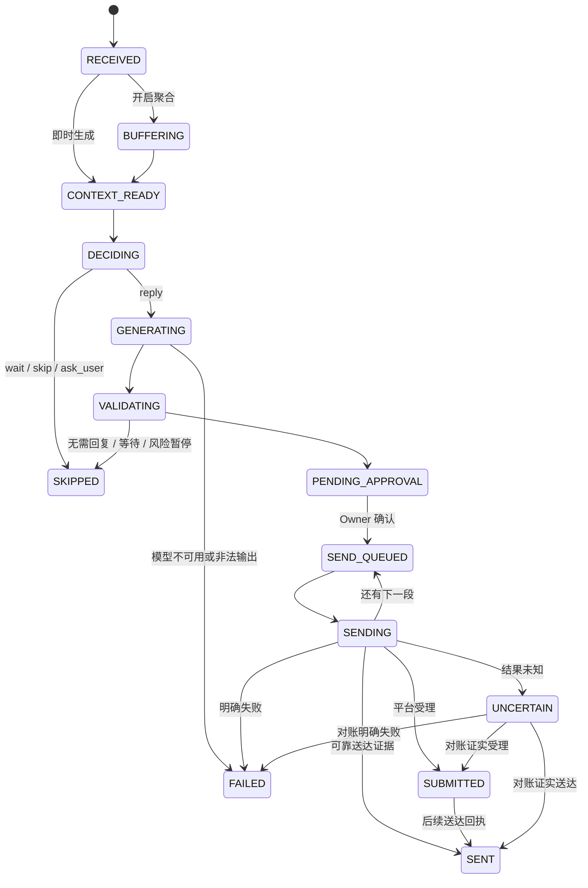

# 回复管线 v2：P1–P5 已实现部分

入口仍为 `PgConfirmedService.ingestPlatformEvent`，DTO 仍使用现有 eventVersion=1；未知事件版本在写入前拒绝。`pipeline_version=2` 为每个已接收批次创建任务并保留触发消息、conversation revision、generation、policy version、快照与 trace ID。

生成/验证阶段可在重启时回到 `CONTEXT_READY` 重建上下文。未提交任务遇到新消息、本人发送、证据变化、策略修改或切换管线时进入 `STALE`；用户可取消未提交任务为 `CANCELLED`。终止状态不会被迟到模型响应复活。`UNCERTAIN`/`SUBMITTED` 不允许转回发送队列，也不能伪装为取消成功。正式 `DECIDING` 阶段留到 P4 独立决策接口，不在 P1 给现有合并调用虚构一个完成阶段。

## 关键约定

- 消息去重使用原 inbox/event ID 与账号/会话范围内的平台消息 ID；重报使用不同内部事件 ID 也不能生成重复有效任务。
- 聚合继续使用原会话锁及数据库窗口；每次追加使上一个批次任务过期，当前任务保存完整批次。崩溃恢复以它的 triggerMessageIds 为准。
- 生成期间不持有数据库事务跨模型调用；返回后检查当前任务 ID、状态、revision、generation、policy/证据/技能版本以及暂停状态。
- 模型返回的草稿字段有业务校验。非法结构、未知 action、自动发送字段等进入 `FAILED` 并暂停；JSON 文本不能成为发送命令。完整独立 Decision JSON Schema 在 P4。
- v2 即使策略 sendMode=auto、测试开启 mockAuto 也只能人工审批；无任何新增真实自动发送入口。
- 审批校验 taskVersion、planVersion、expectedConversationRevision、最终内容 hash 及 idempotencyKey。v1 仍可审批新任务关联的 Plan，但同样受任务 revision 校验。
- 出站继续使用原 send_key、dispatch attempt、同一 advisory boundary；先持久化提交意图再调用平台。多个 worker 只能形成一个有效提交。
- `SUBMITTED` 表示受理；`SENT` 表示可靠送达或现有人工核对流程给出证据。各段状态汇总到同一个回复任务。
- 读任务/trace 没有写副作用。trace 记录状态、原因、版本和时间，不复制完整模型输入、密钥或聊天原文。

P1 新状态合同在 `packages/contracts/reply-pipeline-v2.mts`，持久化在 `postgres/reply-jobs.mts`。发送原实现与权限不迁移到新模块，避免产生两套发送权威。

P4拆开决策、生成和质量阶段，诊断保存最终决策、路由和质量结果。默认fake/text工厂使用新Provider端口；旧自定义测试Intelligence兼容直接propose接口。P5响应式网页通过同一reply-job审批接口确认最终文字；失败重试产生新批次，UNCERTAIN不可重发。配置改变使生成中/待审批任务过期，真实送达后补充反馈。详见 [决策与生成](decision-generation-v2.md)。
