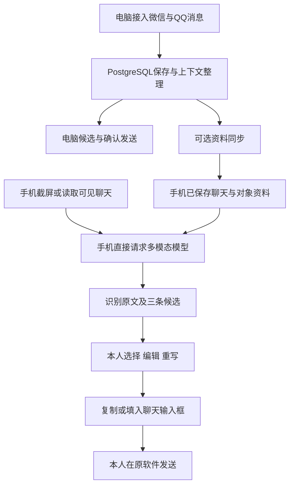

# 项目梳理（2026-10-11）

本次依据当前工作区代码、构建产物、Git 状态和已有交付报告梳理。没有启动平台桥接、调用真实模型、操作手机或重新运行测试。测试数字是已有记录，不代表本次重新验证。本文是项目地图和状态快照；后续计划与状态仍以 `docs/development-plan.md` 为入口。

## 1. 项目定位与当前重点

这是个人聊天回复辅助项目，现有两条产品路径，并通过可选资料同步连接：

| 路径 | 如何使用 | 依赖 | 当前地位 |
| --- | --- | --- | --- |
| 安卓独立回复助手 | 截屏／读取可见聊天 → 模型给三条建议 → 编辑／重写 → 填入或复制 → 本人在聊天软件发送 | 手机、本人配置的云端模型 | 当前主线，优先让日常操作顺手 |
| 电脑微信／QQ代理 | 平台接入来信 → 保存上下文 → 生成候选 → 本人确认 → 对应桥接发送 | 常开电脑、PostgreSQL、已登录的平台接入程序、模型 | 已有文字闭环，继续完善实际可用性 |
| 手机电脑联动 | 配对与关联对象 → 同步可靠聊天、偏好与背景 → 电脑整理 → 手机缓存使用 | 首次及同步时电脑在线、同一局域网 | 支持手机使用，电脑离线后缓存仍可用 |

最新优先级来自开发计划 2026-10-09 的要求：手机回复流程 → 编辑与对象切换 → 聊天记录与上下文衔接 → 电脑联动 → 电脑自动回复。早期 PRD 中的自动代聊、完整历史导入和复杂管理能力，不能全部视为当前已交付范围。

## 2. 核心流程

手机截图流程用同一次多模态请求识别并起草，本地 OCR 是已有辅助能力。无障碍读取限于可见聊天，填写输入框不点击发送；通知另有本人触发的快捷回复路径。复制、填入和未发送草稿不能当作已发送聊天，也不能直接变成本人表达样本。

## 3. 工程地图

| 目录／文件 | 责任与阅读入口 |
| --- | --- |
| `apps/android` | Kotlin + Jetpack Compose 原生手机 App；本地 SQLite 保存档案、聊天、草稿，OkHttp 调用模型与电脑联动 |
| `apps/android/.../data/AssistantController.kt` | 手机主要流程协调：对象、截图、生成、草稿、咨询与联动 |
| `apps/android/.../ai/ModelClient.kt` | 文字回复、多模态截图回复与咨询请求 |
| `apps/android/.../domain` | 上下文、个人表达、聊天记录、通知身份、截图拼接及联动数据 |
| `apps/android/.../platform` | 悬浮窗、截屏、通知、可见聊天读取与输入框填写 |
| `apps/android/.../ui` | 回复面板、聊天记录、军师咨询、联动与设置页面 |
| `apps/core` | 电脑常驻核心：管理 API、收集／生成任务、恢复与健康检查；不直接派发平台消息 |
| `apps/bridge` | 微信和 QQ 桥接进程；各自处理接收、平台发送与守护 |
| `apps/web` | React + Vite 工作台：聊天、候选确认、暂停恢复、运行状态和手机联动 |
| `packages/platform` | QQ OneBot／NapCat、微信 wxhelper 及模拟平台适配 |
| `packages/orchestration` | 名单、会话、确认、发送任务、暂停恢复、调度与版本控制 |
| `packages/data` | 消息、上下文、事实、媒体、分析、反馈与导入基础接口 |
| `packages/ai` | 理解、策略、候选生成、DeepSeek 接入、提示词版本、风格、预算与回放 |
| `packages/link` | 配对、设备授权、资料同步、冲突处理及电脑上下文整理 |
| `packages/skills` | 电脑技能注册、选择与调用底座；手机内置军师是固定技能包 |
| `packages/contracts`、`packages/infrastructure` | 公共类型与接口、数据库事务、身份验证、事件和发送账本 |
| `db/migrations` | 数据库迁移，目前文件到 `0014_mobile_link.sql` |
| `tests`、`scripts`、`deploy` | 自动验证、诊断与启动脚本、部署配置和运行手册 |
| `output/android` | 已构建 APK、验证汇总、日志和界面截图；不纳入 Git |

当前电脑端实际使用 Node.js 原生 HTTP 服务与 `pg`，根包要求 Node ≥22。架构文档里 Fastify 等内容属于早期建议，应与实际代码区分。

## 4. 功能状态

| 能力 | 当前证据与边界 |
| --- | --- |
| 手机截图识别并生成回复 | 已实现；0.2.1 报告记录过红米上的真实模型合成图片闭环。后续真实聊天识别质量仍需试用 |
| 三条候选、编辑、重写、复制／填写 | 已实现；0.5.0 加入面板高度、键盘适配、取消／重试、按对象恢复操作和候选策略 |
| 聊天档案与记录 | 已实现；搜索、补充／纠正、截图去重和顺序处理。记录只覆盖已获取或同步的内容 |
| 个人风格与反馈 | 已实现样例筛选、表达统计和偏好保存；自然度需要实际聊天判断 |
| 狗头军师与关系记忆 | 已实现固定技能、多轮咨询与按对象授权记忆；咨询和候选不自动视为真实发言 |
| 手机电脑联动 | 0.6.0 已实现独立页面、搜索、同步状态、离线缓存与冲突选择；真实同一 Wi-Fi、真实对象关联待试用 |
| 电脑微信文字闭环 | 既有报告记录已真机跑通且判通过；受客户端 3.9.11.25 限制，发送缺平台消息 ID，需人工核对后恢复 |
| 电脑 QQ 文字闭环 | 10/4 报告记录已真机跑通，当前计划仍标记待本人判定 |
| 两平台同时运行 | 隔离测试与双桥接演练有记录；本人实际双平台闭环待完成 |
| 电脑图片理解 | 获取与理解链路已有代码，默认关闭；环境配置模板与真实图片试用仍有未完项 |
| 完整聊天历史导入 | 只有格式中立的导入基础接口；格式解析器、持久导入与使用入口尚未完成，等待导出样本 |
| 电脑通用技能管理／导入／故障资源页 | 部分底座或展示已有；Owner API 对 `/skills`、`/imports`、`/faults` 仍明确返回 501 |
| 语音、自动回复、跨网络联动、电脑关机后运行 | 手机语音后续；微信语音理解研究搁置；其余尚非当前交付主线 |

## 5. 版本与验证情况

- 安卓源码为 `0.6.0` / `versionCode 16`，`output/android/reply-assistant-0.6.0-debug.apk` 实际存在，为个人试用 debug 包。
- 0.6.0 报告记录 10/9 已覆盖安装到目标红米并打开 App。本次没有连接手机查询当前安装状态。
- `output/android/verification-0.6.0.json` 记录 65 项 JVM 测试通过；模拟器全量与修复复验合并后，59 项覆盖中 57 通过、2 跳过；报告记录 Lint 0 错误、23 警告。不是一轮无失败的完整运行，初始运行及复验日志均保留。
- 电脑完整 `npm run verify` 的最近状态入口记录为 10/6：804 pass、0 fail、0 skip。0.6.0 联动交付另有针对性服务、浏览器与网页构建验证，但该轮未重跑 PostgreSQL 持久层集成。
- 根 `npm run verify` 和现有 CI 都不包含安卓检查；不能用电脑验证结果代表手机已验证。

## 6. 启动与交付边界

手机可独立运行：安装 APK，在设置里配置支持图片的模型接口、模型名称与 Key，再按需开启悬浮、通知和无障碍。电脑联动为可选项。

电脑源码入口由 `package.json` 定义：

- `npm run serve:local`：管理数据库、核心与启用的桥接进程；需要已有私有配置和平台环境。
- `npm run serve:core`：常驻核心；`serve:bridge` 与 `serve:wechat-receive`：平台桥接。
- `npm run serve:owner`：使用模拟平台与假模型的开发组合根，不能拿它验证真实平台接入。
- `npm run build:web`：构建电脑工作台；`scripts/build-android.ps1`：安卓构建与检查。

本次直接读取快捷方式目标，确认根目录的「启动项目」「停止项目」「检查启动配置」都指向 `.local-workspace-release`，并以该目录为工作目录。因此存在源码目录和实际启动副本两个位置；修改源码后应核对发布副本和网页产物是否更新，不能仅凭源码版本推断实际运行版本。

手机浏览器访问电脑工作台使用已有局域网 HTTP 方案；原生 App 的电脑同步使用独立 HTTPS 联动服务与配对证书，两者是不同入口。

## 7. 目前最值得处理的问题

1. **先完成真实手机使用反馈闭环。** 重点检查红米上的悬浮与键盘、微信／QQ可见聊天读取和填写、对象切换、模型速度与建议质量，再据反馈安排改动。
2. **整理可复现的交付版本。** 本次新增本文前 Git 显示 78 个已跟踪文件修改、79 个未跟踪条目，最近提交仍是 10/7 的安卓 0.3.4；后续功能大量留在工作区。应按手机、电脑联动和电脑工作台等实际交付范围检查并提交必要源码，保留私有配置与日志的排除规则。
3. **核对源码、发布副本与 APK 的对应关系。** 日常启动快捷方式运行副本，手机运行构建包；问题定位需要知道两端实际加载版本。
4. **收敛文档中的旧信息。** `architecture.md` 缺安卓和联动部分且仍有早期技术建议；开发计划中的「迁移已到0013，下一0014」已落后于实际迁移文件；根 `PLAN.md` 是 PowerShell 安装迁移计划，不是聊天助手路线图。旧文档可保留，但应明确用途和时间。
5. **按需要补齐功能。** 电脑图片理解配置、历史导入样本与解析器、真实双平台验收仍有明确缺口。语音、自动回复、云部署和通用技能管理按后续需求排期。

## 8. 后续阅读顺序

1. `docs/development-plan.md`：当前优先级、状态与未完事项。
2. `docs/android-requirements.md`、`apps/android/README.md`：手机产品与操作规则。
3. `docs/reports/android-mobile-flow-2026-10-09.md`、`android-link-ux-2026-10-09.md`：最近两批交付和验证限制。
4. `apps/core/README.md`、`apps/bridge/README.md`、`apps/web/README.md`、`deploy/runbook.md`：电脑路径。
5. `docs/contracts.md`、`packages/contracts`：准备修改跨模块接口时阅读。

总体判断：项目已有可安装的手机助手和电脑文字确认闭环，当前处于个人试用与体验完善阶段。继续推进应围绕实际手机使用和版本交付，而非重新铺设已有底座。
